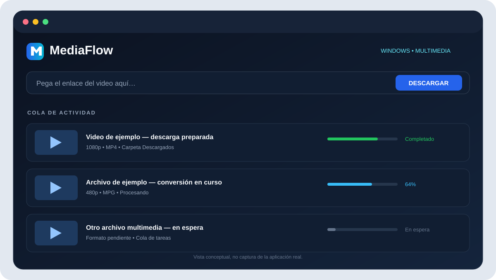

<!-- MediaFlow README -->
<p align="center">
  <picture>
    <source media="(prefers-color-scheme: dark)" srcset="artwork/mediaflow-banner-dark.svg">
    
  </picture>
</p>

<p align="center"><strong>Descarga, convierte y organiza tus archivos multimedia desde una sola aplicación para Windows.</strong></p>

<p align="center">
  <a href="https://github.com/Arturr12/MediaFlow/releases/latest"></a>
  <a href="https://img.shields.io/github/actions/workflow/status/Arturr12/MediaFlow/publish-release.yml?branch=main&style=for-the-badge&logo=githubactions&label=Build"></a>
  <a href="https://github.com/Arturr12/MediaFlow/releases"></a>
  
</p>

<p align="center">
  <a href="https://github.com/Arturr12/MediaFlow/releases/latest"></a>
  <a href="https://github.com/Arturr12/MediaFlow/releases"></a>
</p>

---

## ✨ ¿Qué es MediaFlow?

**MediaFlow** es una aplicación de escritorio para Windows que reúne herramientas de descarga y conversión multimedia en una interfaz moderna. Permite administrar tareas, elegir formatos y controlar archivos desde un mismo lugar.

## 🖥️ Vista de la aplicación

<p align="center"></p>
<p align="center"><sub>Ilustración conceptual; no es una captura de la interfaz real.</sub></p>

## 🚀 Funciones principales

| Descargas | Conversión |
|---|---|
| Gestión de tareas desde una cola. | Conversión mediante FFmpeg. |
| Miniaturas e información del contenido cuando están disponibles. | Selección de formato y calidad. |
| Selección de formato y calidad. | Procesamiento de archivos y carpetas. |
| Seguimiento del progreso. | Perfiles de conversión. |

| Control de tareas | Actualizaciones |
|---|---|
| Cola de actividad y estados. | Comprobación de nuevas versiones en GitHub Releases. |
| Seguimiento de progreso. | Avisos dentro de la aplicación. |
| Controles de cancelación. | Descarga autorizada por el usuario. |
| Miniaturas para identificar videos. | Verificación SHA-256 del instalador. |

## 📥 Instalación

1. Abre [Releases](https://github.com/Arturr12/MediaFlow/releases/latest).
2. Descarga el instalador **MediaFlow-Setup** de la última versión.
3. Ejecuta el instalador y sigue las indicaciones.
4. Inicia MediaFlow desde Windows.

**Requisitos:** Windows de 64 bits. Consulta las notas de cada versión para conocer los componentes requeridos.

## 🔄 Actualizaciones automáticas

MediaFlow consulta las publicaciones estables de este repositorio. Cuando detecta una versión posterior, muestra una notificación para que el usuario decida si desea actualizar.

El manifiesto de actualización contiene la versión y el SHA-256 del instalador. La aplicación verifica el archivo descargado antes de iniciar el proceso.

- [Versiones publicadas](https://github.com/Arturr12/MediaFlow/releases)
- [Historial de compilaciones](https://github.com/Arturr12/MediaFlow/actions)

## 🧰 Compilar desde el código fuente

### Requisitos

- Windows 10/11 de 64 bits.
- Python 3.13 de 64 bits.
- Git for Windows.
- Inno Setup 6 o 7.

### Ejecutar en modo portable

```bat
run_portable.bat
```

### Crear el instalador localmente

```bat
build_installer.bat
```

## 📦 Publicar una nueva versión

Las publicaciones se construyen con GitHub Actions al subir una etiqueta `vX.Y.Z`.

1. Actualiza `RELEASE_NOTES.md`.
2. Ejecuta `PUBLICAR-NUEVA-VERSION.bat`.
3. Introduce la nueva versión, por ejemplo `0.4.5`.
4. Revisa el proceso en [GitHub Actions](https://github.com/Arturr12/MediaFlow/actions).
5. Al terminar, GitHub publicará el instalador y el manifiesto en Releases.

## 🛡️ Seguridad y transparencia

- Las actualizaciones se consultan mediante HTTPS.
- El instalador se verifica con SHA-256 antes de ejecutarse.
- La instalación requiere autorización del usuario.
- No se incluyen tokens personales de GitHub en las instalaciones.

## 🧩 Tecnologías

<p>
  
  
  
  
  
</p>

## 🐛 Reportar un problema

Abre un [Issue](https://github.com/Arturr12/MediaFlow/issues) e incluye tu versión de MediaFlow, versión de Windows, pasos para reproducir el problema y el mensaje de error relevante. No publiques datos personales.

## 📄 Licencias y dependencias

Consulta [THIRD_PARTY_NOTICES.txt](THIRD_PARTY_NOTICES.txt) para los avisos de componentes de terceros. La licencia de distribución del propio proyecto debe definirse explícitamente por sus responsables.

---

<p align="center"><strong>MediaFlow</strong><br><sub>Un solo lugar para tus tareas multimedia.</sub><br>
<a href="https://github.com/Arturr12/MediaFlow/releases/latest">Descargar</a> ·
<a href="https://github.com/Arturr12/MediaFlow/issues">Reportar un problema</a> ·
<a href="https://github.com/Arturr12/MediaFlow/actions">Ver compilaciones</a></p>
